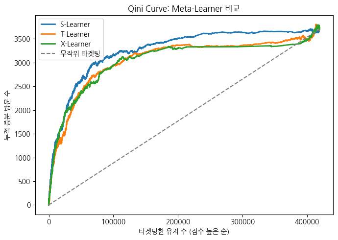
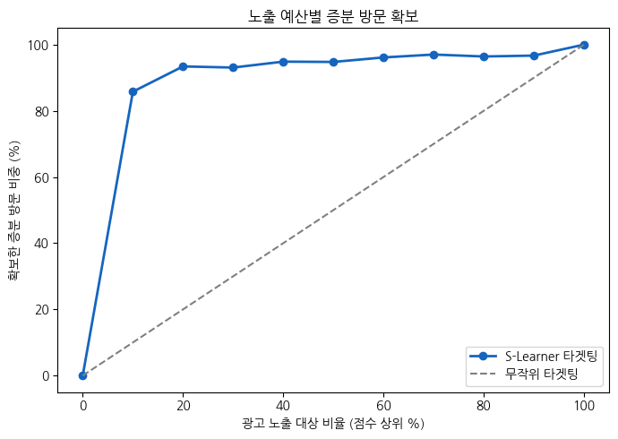

# Who-Needs-the-Ad

**광고가 정말 필요한 사람은 누구인가**

광고 노출 예산이 한정되어 있을 때, 누구에게 광고를 보여줘야 증분 방문과 구매가 가장 커질까?
"광고를 보면 방문할 사람"이 아니라 **"광고를 봐서 방문이 늘어나는 사람"** 을 찾는 Uplift Modeling 프로젝트입니다.

<br>

## 핵심 결과

| 항목 | 결과 |
|---|---|
| 배정 효과와 노출 효과 | 캠페인 배정 효과 +1.01%p는 실제 노출률 3.61%에 희석된 값이었고, 노출자 기준 방문 확률은 **+28.0%p** |
| 방법론 선택 | 이론상 유리한 X-Learner가 아니라, 비교 검증에서 가장 높은 **S-Learner** 선택 (부트스트랩 50회 중 94% 우세) |
| 타겟팅 효율 | 상위 10%에만 노출해도 증분 방문의 **85.8%**, 증분 구매의 **79.6%** 확보 (무작위 대비 **8.6배**) |
| 역효과 그룹 | 예측 uplift가 음수인 유저(6.6%)의 실제 효과는 0과 구분되지 않아, 이전 프로젝트의 '역효과 그룹' 주장을 바로잡음 |
| 예산 판단 기준 | 광고 단가를 가정하지 않고, 분위별 한계 효율로 노출 범위를 정하는 기준 제시 |

<br>

## 문제 정의

일반적인 반응 예측 모델은 "광고를 보면 방문할 확률이 높은 사람"을 찾습니다.
하지만 그중에는 **광고를 보지 않아도 어차피 방문할 사람**이 섞여 있고, 이들에게 쓰는 노출은 예산 낭비입니다.

그래서 질문을 바꿨습니다.

> "이 사람이 방문할 확률"이 아니라, **"이 사람에게 광고를 보여줬을 때 방문 확률이 얼마나 더 오르는가(증분)"**

<br>

## 분석 과정

### 1단계. 데이터 확인: 배정과 노출은 다르다

[Criteo Uplift Prediction Dataset v2.1](https://huggingface.co/datasets/criteo/criteo-uplift)을 사용했습니다.
Criteo가 공개한 실제 온라인 광고 **무작위 배정 실험** 데이터이며, 10% 샘플(1,397,959건)로 분석했습니다.

| 컬럼 | 의미 | 값 |
|---|---|---|
| `f0` ~ `f11` | 익명화된 유저 피처 | 12개 |
| `treatment` | 광고 캠페인 대상 **배정** 여부 (무작위) | 처치군 85.0%, 대조군 15.0% |
| `exposure` | 실제 광고 **노출** 여부 | 처치군 중 3.61%, 대조군 0% |
| `visit` | 사이트 방문 | 4.70% |
| `conversion` | 구매 전환 | 0.30% |

**발견한 점**
- 캠페인 대상으로 배정된 유저 중 실제로 광고를 본 비율은 **3.61%** 뿐이었습니다.
- 대조군은 광고를 아예 볼 수 없는 구조였습니다 (노출률 0%).
- 실제 노출은 무작위가 아닙니다. 활발한 유저일수록 광고를 더 많이 보고, 원래 방문도 더 많이 합니다. 그래서 노출자와 비노출자를 직접 비교하지 않고, **무작위 배정(`treatment`)을 기준**으로 효과를 추정했습니다.
- 구매는 방문보다 15배 이상 드물어, **방문을 학습 타깃**으로 쓰고 구매는 검증용으로 사용했습니다.

<br>

### 2단계. 평균 효과: 배정 효과와 실제 노출 효과 구분

| 구분 | 방문 | 구매 |
|---|---|---|
| 대조군 → 처치군 | 3.84% → 4.85% | 0.19% → 0.31% |
| 배정 효과 (ITT) | **+1.01%p** (95% CI 0.92 ~ 1.10) | **+0.13%p** (95% CI 0.11 ~ 0.15) |
| 상대 증가율 | +26.4% | **+67.6%** |
| 노출 효과 (Wald 추정) | **+28.0%p** | +3.51%p |

- 배정 효과는 신뢰구간이 0과 충분히 떨어져 있어, 캠페인 효과가 우연이 아님을 확인했습니다.
- 배정 효과를 실제 노출률(3.61%)로 나누면, **광고를 실제로 본 유저의 방문 확률은 약 28%p** 올라갑니다.
- 구매의 상대 증가율이 방문의 약 2.5배로, 광고는 방문보다 **구매에 상대적으로 더 큰 영향**을 줬습니다.

**해석할 때 주의한 점**
- 노출 효과는 "실제로 노출된 유저"에 대한 효과입니다. 모든 유저에게 노출했을 때의 효과로 일반화할 수 없습니다.
- "배정만 되고 광고를 보지 않은 유저는 행동이 바뀌지 않는다"는 가정에 의존합니다.

<br>

### 3단계. 데이터 분할과 기존 결과 재현

- 학습 70%, 평가 30%로 나누고, 처치 여부 비율이 같도록 층화했습니다.
- 학습 데이터의 처치군은 831,964명, 대조군은 146,607명으로 **약 85 : 15로 불균형**했습니다.
- 이전 프로젝트 [Re-Collection](https://github.com/hwasun-zip/Re-Collection)과 같은 샘플링, 분할 설정을 사용해 **T-Learner의 Qini AUC 0.0803이 그대로 재현**되는 것을 먼저 확인했습니다. 같은 출발점에서 방법만 바꿔 비교하기 위해서입니다.

<br>

### 4단계. 세 가지 Meta-Learner 학습

같은 LightGBM 설정으로 세 방법을 학습했습니다.

| 방법 | 아이디어 | 예상한 장단점 |
|---|---|---|
| S-Learner | 모델 1개에 `treatment`를 피처로 넣고, 1과 0을 바꿔 넣은 예측 차이를 uplift로 사용 | 단순하지만 uplift가 0 근처로 눌릴 수 있음 |
| T-Learner | 처치군 모델과 대조군 모델을 따로 학습해 예측 차이를 uplift로 사용 | 직관적이지만 두 모델의 오차가 더해짐 |
| X-Learner | T-Learner 예측으로 유저별 가상 효과를 만들고, 그 효과를 다시 학습 | 그룹 크기가 불균형할 때 유리하다고 알려짐 |

**처음 세운 가설**: 대조군이 15%뿐이므로, 불균형에 강한 **X-Learner가 가장 좋을 것이다.**

**예측값 분포**

| 모델 | 예측 uplift 범위 | 표준편차 |
|---|---|---|
| S-Learner | -0.123 ~ 0.358 | 0.0219 |
| T-Learner | -0.384 ~ 0.676 | 0.0319 |
| X-Learner | -0.323 ~ 0.776 | 0.0286 |

S-Learner의 예측이 가장 덜 퍼져 있었습니다. 다만 퍼진 정도만으로는 좋은 모델인지 알 수 없어, 실제 처치 결과로 평가했습니다.

<br>

### 5단계. 모델 평가: 가설과 다른 결과

| 모델 | Qini AUC (방문) | Uplift AUC (방문) | Uplift@10% | Qini AUC (구매) |
|---|---|---|---|---|
| **S-Learner** | **0.0937** | **0.0366** | **0.0696** | **0.2246** |
| T-Learner | 0.0803 | 0.0314 | 0.0614 | 0.1860 |
| X-Learner | 0.0791 | 0.0309 | 0.0603 | 0.1716 |



- 가설과 달리 **가장 단순한 S-Learner가 모든 지표에서 가장 높았습니다.**
- T-Learner와 X-Learner는 두 모델의 오차가 더해져 예측이 넓게 퍼졌고, 그 노이즈가 순서를 흐린 것으로 보입니다. S-Learner는 처치군과 대조군을 한 모델로 학습해, 대조군이 적다는 약점을 덜 탔습니다.
- X-Learner도 1단계에서 T-Learner의 모델을 그대로 쓰기 때문에, 같은 노이즈를 물려받아 T-Learner를 넘지 못했습니다.
- 방문으로만 학습했지만, 같은 점수가 **구매 증분도 같은 순서로 가장 잘 줄 세웠습니다.**

**순위가 우연이 아닌지 확인 (부트스트랩)**

평가 데이터를 50회 복원추출하고, 매번 같은 표본에서 세 모델을 동시에 비교했습니다.

| | S-Learner | T-Learner | X-Learner |
|---|---|---|---|
| Qini AUC 중앙값 | 0.0953 | 0.0802 | 0.0784 |
| 95% 구간 | 0.0748 ~ 0.1091 | 0.0662 ~ 0.0994 | 0.0662 ~ 0.0916 |

- 각 모델의 구간은 겹치지만, 같은 표본에서 짝지어 비교하면 **50회 중 94%에서 S-Learner가 T, X-Learner보다 높았습니다.**
- 그래서 이론보다 검증 결과를 따라 **S-Learner를 최종 모델로 선택**했습니다.

<br>

### 6단계. 10분위 분석: 증분 효과는 어디에 몰려 있나

S-Learner 점수가 높은 순서로 10개 구간으로 나누고, 구간별로 **실제** 처치군과 대조군의 반응률 차이를 계산했습니다.

| 분위 | 방문 (대조 → 처치) | 증분 방문 누적 비중 | 구매 (대조 → 처치) | 증분 구매 누적 비중 |
|---|---|---|---|---|
| 1 | 21.1% → 28.1% | **85.8%** | 1.26% → 2.23% | **79.6%** |
| 2 | 8.7% → 9.4% | 93.4% | 0.27% → 0.43% | 93.0% |
| 3 ~ 9 | 증분 ≈ 0 | 96.7% | 증분 ≈ 0 | 98.2% |
| 10 | 6.0% → 6.3% | 100.0% | 0.26% → 0.28% | 100.0% |

- **상위 10%가 증분 방문의 85.8%, 증분 구매의 79.6%** 를 차지했습니다.
- **유저의 70% (3 ~ 9분위)는** 광고 노출 여부와 무관하게 행동이 거의 같았습니다.
- 1분위는 원래 방문률도 높지만, 상대 증가율(+33%)이 전체 평균(+26%)보다 높았습니다. 단순히 활발한 유저가 아니라 **광고에 특히 더 반응하는 유저**를 골라냈습니다.
- 이전 프로젝트(T-Learner)에서 맨 아래 10분위가 증분의 9.1%를 차지하던 이상 구간은, S-Learner에서 약 3.3%로 줄었습니다.
- 구매는 매우 드물어 하위 분위의 값은 해석하지 않고, 상위에 몰리는 흐름만 확인했습니다.

<br>

### 7단계. 광고가 역효과를 내는 유저가 정말 있을까

이전 프로젝트에서는 median split으로 '광고가 역효과를 내는 그룹(Sleeping Dogs) 2.8%'를 정의했지만, 그 그룹의 실제 효과는 검증하지 않았습니다.
이번에는 정의를 **"예측 uplift가 음수인 유저"** 로 바꾸고, 실제 효과를 신뢰구간과 함께 확인했습니다.

| 그룹 | 비중 | 예측 uplift 평균 | 실제 uplift (95% CI) |
|---|---|---|---|
| 예측 uplift < 0 | 6.6% (27,873명) | -0.24%p | +0.45%p (-0.48 ~ +1.38) |
| 예측 uplift ≥ 0 | 93.4% | | +1.10%p (+0.93 ~ +1.26) |

- 예측 음수 그룹의 실제 효과는 **0과 구분되지 않았고**, 점추정은 오히려 양수였습니다.
- 그래서 이 그룹을 **'노출 회피'가 아니라 '후순위'** 로 재정의했습니다. 결정은 같지만 이유가 다릅니다.
- 역효과를 확인하려면 이 그룹의 대조군을 늘린 별도 실험이 필요합니다.

<br>

### 8단계. 노출 예산 시뮬레이션

광고 단가를 임의로 가정하지 않고, **무작위 타겟팅 대비 효율**로 비교했습니다.



| 노출 대상 | 확보한 증분 방문 비중 | 무작위 대비 효율 |
|---|---|---|
| 상위 10% | 85.8% | **8.6배** |
| 상위 20% | 93.4% | 4.7배 |
| 상위 50% | 94.8% | 1.9배 |
| 전체 | 100.0% | 1.0배 |

분위별로 **추가 노출 1,000명당 늘어나는 방문**을 따로 보면 차이가 더 분명합니다.

| 구간 | 추가 노출 1,000명당 증분 방문 | 무작위 평균(8.12) 대비 |
|---|---|---|
| 1분위 | 69.6 | 8.6배 |
| 2분위 | 6.2 | 0.8배 |
| 3 ~ 9분위 | 평균 0.4 | 거의 0 |
| 10분위 | 2.7 | 0.3배 |

- 2분위부터는 추가 노출의 효율이 무작위 평균보다 낮습니다. 예산이 제한되면 **상위 10%에 집중**하는 것이 합리적입니다.
- 광고 단가가 바뀌어도 그대로 쓸 수 있는 판단 기준을 세웠습니다.

> **분위의 "1,000명당 증분 방문 × 방문 1건의 가치"가 "1,000명 노출 비용"보다 클 때만 그 분위까지 노출한다.**

<br>

## Re-Collection과 달라진 점

같은 데이터로 채권 회수 도메인에 Uplift Modeling을 적용한 [Re-Collection](https://github.com/hwasun-zip/Re-Collection)에서 출발해, 데이터의 원래 도메인인 광고의 질문으로 확장했습니다.

| 항목 | Re-Collection | Who-Needs-the-Ad |
|---|---|---|
| 도메인 | 채권 회수 (재해석) | 광고 (데이터 원래 도메인) |
| 처치 정의 | `treatment`를 "노출"로 해석 | `treatment`(배정)와 `exposure`(노출) 구분 |
| 타깃 | 방문 | 방문 학습, 구매로 검증 |
| 모델 | T-Learner | S, T, X-Learner 비교와 부트스트랩 검증 |
| 역효과 그룹 | median split으로 정의 | 실제 효과를 검증해 근거 없음을 확인 |
| 의사결정 | 채널 배정 | 단가 가정 없는 예산 판단 기준 |

<br>

## 한계

- 피처가 익명화되어 있어, 증분 효과가 큰 유저가 '어떤 유저인지' 비즈니스 언어로 해석할 수 없습니다.
- 노출 효과(Wald)는 "배정만 되고 광고를 보지 않은 유저는 행동이 바뀌지 않는다"는 가정에 의존합니다.
- 예산 시뮬레이션의 '1,000명'은 배정 유저 기준입니다. 실제 노출 1회당 효율은 분위별 노출률을 반영해야 합니다.
- 부트스트랩은 평가 데이터의 변동만 반영하며, 모델을 다시 학습할 때의 변동은 반영하지 않습니다.
- 구매는 매우 드물어(0.30%) 하위 분위의 구매 증분 추정은 불확실성이 큽니다.

<br>

## 폴더 구조

```
Who-Needs-the-Ad/
├── notebooks/
│   └── Who_Needs_the_Ad.ipynb
├── outputs/
│   ├── qini_comparison.png
│   └── budget_simulation.png
└── README.md
```

## 실행 방법

Google Colab에서 `notebooks/Who_Needs_the_Ad.ipynb`를 열고 위에서부터 순서대로 실행합니다. 데이터는 HuggingFace에서 자동으로 내려받습니다.

**사용 라이브러리**: pandas, numpy, scikit-learn, LightGBM, scikit-uplift, matplotlib
